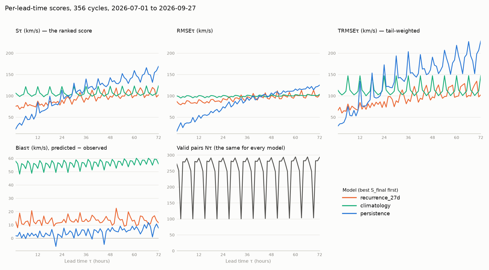

# Scoring demo

This folder shows how submissions are scored, using the competition's own
scoring code on a backlog of forecasts.

> **Note: This is an illustration of the metric, not a preview of the
> leaderboard.** The scores below come from a historical window (July to
> September 2026) that is not part of the competition. Live scores are
> computed over the competition period, against the archive as it stands
> at the time.


## What's here

| Path | What it is |
|---|---|
| `score.py` | Scores one or more forecast files and writes a JSON report. |
| `plot_report.py` | Plots a report's per-lead-time curves. See [The curves](#the-curves). |
| `swp_scoring/` | An unmodified copy of the scoring code that computes the leaderboard. Don't edit it. |
| `baselines/` | The three official baselines, written as submissions: each script takes a t0 and prints a 72-hour forecast. |
| `data/forecasts/` | The backlog we generated: one file per model, one forecast per cycle. |
| `data/ace/` | A snapshot of the ACE archive months the demo window touches. This is the ground truth. |
| `expected_report.json` | What `score.py` should produce from the files above. |
| `expected_curves.png` | `plot_report.py` run on `expected_report.json`. |


## Run scoring 

Python 3.11 or newer:

```bash
pip install -r requirements.txt # numpy
python3 score.py
```

It writes `report.json`, which should be identical to `expected_report.json`.

## Baselines

For every scheduled cycle (00, 06, 12 and 18 UTC) from 2026-07-01 00:00 to
2026-09-27 18:00, we produced a forecast backlog for each baseline:

- **`persistence`**: `baselines/persistence.py`. Every lead time gets the
  latest valid observation at or before t0.
- **`recurrence_27d`**: `baselines/recurrence_27d.py`. The speed observed
  27 days (one solar rotation) earlier. Where that observation is missing,
  it falls back to persistence.
- **`climatology`**: `baselines/climatology.py`. A constant 469.5 km/s,
  fixed before the competition from the 12 months before it.

We ran each baseline script as of each cycle's t0. Because these cycles are
in the past, the whole archive already exists. The scripts only ever read
observations stamped at or before t0 (`observations_until` in
`baselines/ace.py`). That cut-off is what keeps a backtest honest. A live
model running at t0 can't always see even the hour stamped t0, because the
archive is published with a short delay.

You can run any baseline yourself:

```bash
python3 baselines/persistence.py 20260801T060000Z
```

We don't provide a tool for producing rolling backtests of your own model.
How you generate past forecasts depends on your method and data, and that
part is up to you.

## How scoring works

### Intuition

Every six hours, a model issues a new hourly forecast for the next 72 hours. Each lead time τ (1 h, 2 h, …, 72 h) is scored separately: from every forecast issued during the competition period, we collect the τ-hour-ahead prediction, forming one set of predictions per lead time. Within each set, every prediction is compared with the ACE observation it targets, and we compute the root-mean-squared error in two ways: (1) ordinary RMSE, which weights all predictions equally, and (2) a tail-sensitive RMSE, which weights each prediction by how fast the observed solar wind was, so that errors during rare high-speed events count for more. The lead’s score is the geometric mean of these two RMSEs (in km/s), so a 1% change in either moves the score equally. The final score is the simple average of the 72 lead scores, so every horizon counts the same. Lower is better.


### The grid

The scorer builds a matrix with one row for every scheduled cycle in the
window and one column for every lead time τ = 1..72 hours. Every team is
scored on the same rows.

- **Observations:** `obs[t0, τ]` is the archive's speed at t0 + τ. An
  observation is valid only if its status flag is 0 and its speed isn't the
  −9999.9 sentinel. A missing or invalid observation is excluded for
  everyone alike, and it is never interpolated.
- **Predictions:** `pred[t0, τ]` is your submitted value if it's valid.
  Otherwise it is persistence for that cycle.

### Missing forecasts are filled, not skipped

A missing prediction is replaced with persistence, whatever the reason:

- the run failed or timed out
- a value was null, NaN or non-numeric
- a value was outside 0–10000 km/s
- the forecast didn't have exactly 72 values

The pair is still scored. Leaving out the cycles you'd get wrong can't
improve your score; it just swaps your forecast for persistence. The
`coverage` section of the report shows how many of your values were
filled.

### The metric

Each lead time τ is scored on its own, over every cycle:

- **RMSE_τ**: ordinary root-mean-square error, in km/s.
- **TRMSE_τ**: the square root of the threshold-integrated MSE. This weights errors on fast solar wind more heavily than ordinary RMSE does.
- **S_τ** = √(RMSE_τ · TRMSE_τ).

The ranking score is **S_final, the mean of S_τ over the 72 lead times**,
each with equal weight. Lower is better. The report also gives the mean
RMSE, mean TRMSE, mean bias (predicted − observed), S over leads 49–72 (a
long-range diagnostic that doesn't count towards the ranking), and the
complete per-lead curves.

The thresholds come from observations only, and they are spread across the
whole range of speeds. One forecast is not enough to score: with a single
cycle, every lead has one observation, so TIMSE is zero. The metric needs
many cycles before it means anything.

## Reading the report

`report.json` has three sections:

- **`meta`**: the window, the number of cycles, and a hash of the scoring
  configuration, so you can tell which rules a report was computed under.
- **`coverage`**: one entry per forecast file. It shows how many cycles
  the file covered, how many it had outside the window (ignored), and how
  many of the `cycles × 72` values were valid or filled with persistence.
- **`scores`**: one entry per model, with these fields:

| Field | What it is |
|---|---|
| `s_final` | The ranked score: the mean of `s_curve`. |
| `mean_rmse`, `mean_trmse` | The means of `rmse_curve` and `trmse_curve`. |
| `mean_bias` | The mean of `bias_curve`. Positive means the model forecasts too fast on average. |
| `s_49_72` | The mean of `s_curve` over leads 49–72 h. A long-range diagnostic, not ranked. |
| `n_leads` | How many lead times had at least one valid pair (72 once the window has settled). |
| `s_curve` | S_τ for τ = 1..72: the score at each lead time. |
| `rmse_curve` | RMSE_τ: ordinary error at each lead time. |
| `trmse_curve` | TRMSE_τ: tail-weighted error at each lead time. |
| `bias_curve` | Mean(predicted − observed) at each lead time, in km/s. |
| `n_curve` | N_τ: how many (cycle, observation) pairs were scored at each lead time. |

Every curve is a list of 72 values, where index 0 is τ = 1 h. A lead time
with no valid observation is `null` and is left out of every mean.

### The curves

S_final says which model is better. The curves say where it's better, and
why. Plot any report with `plot_report.py` (it needs matplotlib, which
`score.py` doesn't):

```bash
pip install matplotlib
python3 plot_report.py report.json -o curves.png
```

This is the demo's report:



Some things to notice:

- **Persistence is the best model for the first day and the worst by day
  three.** Its S_τ is about 20 km/s at 1 h and grows steadily with
  lead time. Any model has to beat persistence at short leads to justify itself
  there.
- **27-day recurrence wins overall because it degrades the least.** It is
  worse than persistence for the first 24 hours or so. But it doesn't get
  worse with lead time, because it isn't extrapolating from t0.
- **Climatology is flat in lead time**, because it doesn't look at t0.
  Its curves show how hard each lead time's observations are to predict
  with a single number.
- **RMSE and TRMSE can disagree.** Persistence has a lower mean RMSE than
  climatology (84 against 99 km/s) but a much higher mean TRMSE (138
  against 114). When a fast stream arrives, persistence keeps forecasting
  the slow wind it saw at t0. Those misses are on the fastest
  observations, which TRMSE weights most. S_τ rewards a model for being
  good at both.
- **Bias shows what the error is made of.** Climatology forecasts about
  55 km/s too fast at every lead. Its constant comes from a faster year
  than this window, so most of its error is that offset.

## Baseline comparisons

```
356 cycles, 2026-07-01T00:00:00Z .. 2026-09-27T18:00:00Z  (lower is better, km/s)

                               S_final      RMSE     TRMSE      bias   S_49:72    filled
recurrence_27d                   93.51     93.86     93.61     13.28    105.03        0%
climatology                     106.46     99.48    114.31     55.80    107.23        0%
persistence                     107.77     84.31    138.40      4.38    144.28        0%
```

## Scoring your own forecasts

Put your past forecasts in a file in the same format:

```json
{
  "name": "my-model",
  "forecasts": {
    "20260701T000000Z": {"forecast_speed_kms": [72 values]},
    "20260701T060000Z": {"forecast_speed_kms": [72 values]}
  }
}
```

Each key is the cycle's t0 in the form your container receives as
`argv[1]`. Each value is the object your container uploads. Only
`forecast_speed_kms` is read.

```bash
python3 score.py my-model.json data/forecasts/*.json -o my-report.json
```

`--start` and `--end` select another window. Within the shipped archive
months, any window from 2026-07-01 to 2026-09-27 works. Add `--live` to
read ground truth from NASA instead, for any window. A cycle in the window
that your file doesn't cover is filled with persistence, as on the
platform. To keep the comparison fair, also score the baselines over the
same window: the shipped baseline files only cover the demo window, so
outside it add `--official-baselines`, which computes them inside the
scorer.

## Caveats

- **Climatology is in-sample here.** Its constant was computed from
  October 2025 to September 2026, which overlaps the demo window. That
  flatters it a little.
- **Three months is a short window.** Each lead time has at most 356
  pairs, and TRMSE in particular moves noticeably with a few fast-wind
  events.
- **Gaps in the archive.** If the archive has no valid observation in the
  72 hours before some cycle, that cycle has no persistence value. Scoring
  then stops with an error rather than silently dropping pairs. Choose a
  different window.
